# AMZN

E-commerce API and Management Portal

An Amazon-inspired e-commerce backend built with ASP.NET Core, Entity Framework Core and SQL Server. It includes a REST API for a React storefront and a responsive MVC interface for managing the catalog.

The project was built by a team of three frontend and two backend developers using a shared Figma design. This repository contains the backend and MVC management interface. The React storefront is in a separate repository.

## Live demo

**[Explore the API in Swagger](https://amzn-backend.azurewebsites.net/swagger)** · **[Open the admin panel](https://amzn-backend.azurewebsites.net/)**

The backend is hosted on Azure App Service with Azure SQL Database and Azure Blob Storage. The live demo includes the REST API and MVC admin panel. The React storefront is not hosted at this address.

If no one has used the demo for a while, the site may take longer to open. The first action that uses the database (for example, signing in) may be slow. The database can take about 30 seconds to wake up. If the action fails, wait a moment and try again. Use test data when trying the demo.

## My role

I worked on the core backend in the original team project and continued maintaining it afterward. My main areas were the catalog, search and homepage APIs, product ratings, reviews and Q&A, and JWT authentication.

I also built the MVC product editor and integrated Azure Blob Storage for product images. Later, I improved database queries, shared validation rules and upload safeguards, and added automated tests.

## Project preview

### React storefront (client application)

The React storefront was built by the frontend team and has its own repository. These screenshots show it running locally against the AMZN API with demo data.

**Homepage overview** with three main categories, four product groups, popular items and the under-$20 collection.

<p align="center">
<a href="docs/images/storefront-home.png">
  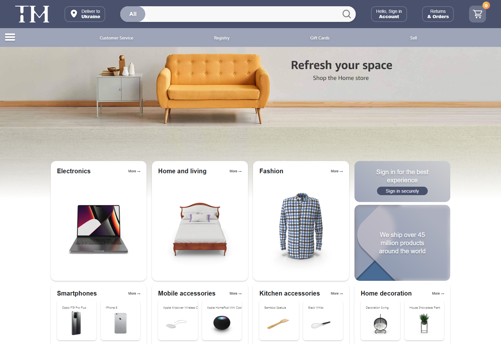
</a>
</p>

**[Open the full-size homepage overview](docs/images/storefront-home.png)**

Click any preview to open the full-size screenshot.

<table>
  <tr>
    <th width="50%">Catalog and filters</th>
    <th width="50%">Storefront search</th>
  </tr>
  <tr>
    <td valign="top">
      <a href="docs/images/storefront-catalog.png">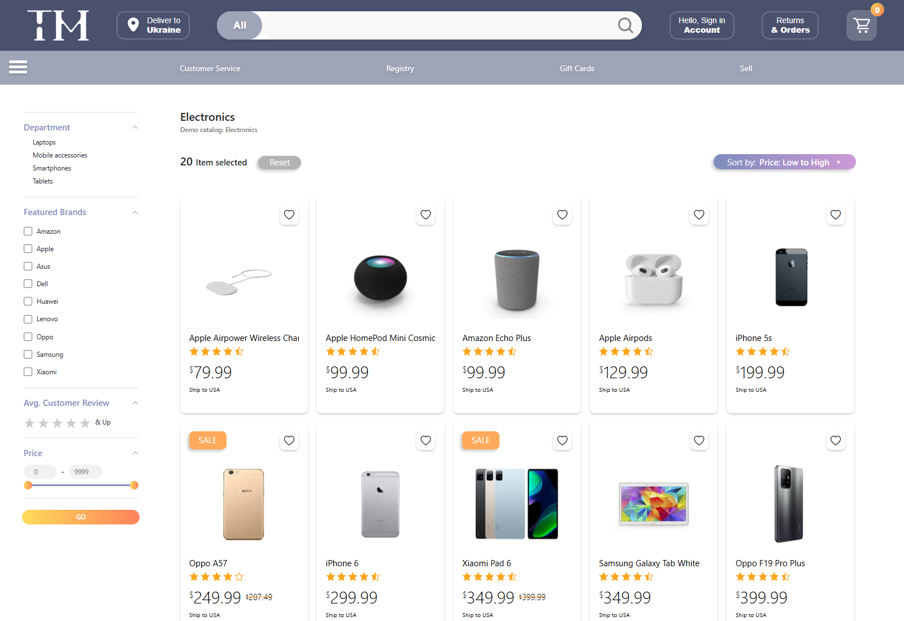</a><br>
      Browse products with filters and sorting.<br>
      <a href="docs/images/storefront-catalog.png">Open full-size screenshot</a>
    </td>
    <td valign="top">
      <a href="docs/images/storefront-search.png">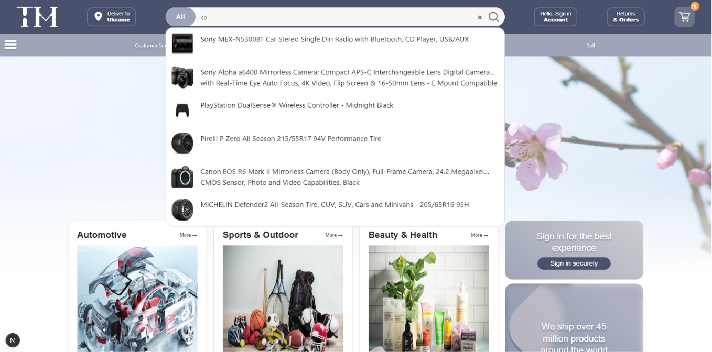</a><br>
      Product suggestions with prices, brands and categories.<br>
      <a href="docs/images/storefront-search.png">Open full-size screenshot</a>
    </td>
  </tr>
  <tr>
    <th width="50%">Product page</th>
    <th width="50%">Homepage collections</th>
  </tr>
  <tr>
    <td valign="top">
      <a href="docs/images/storefront-product.png">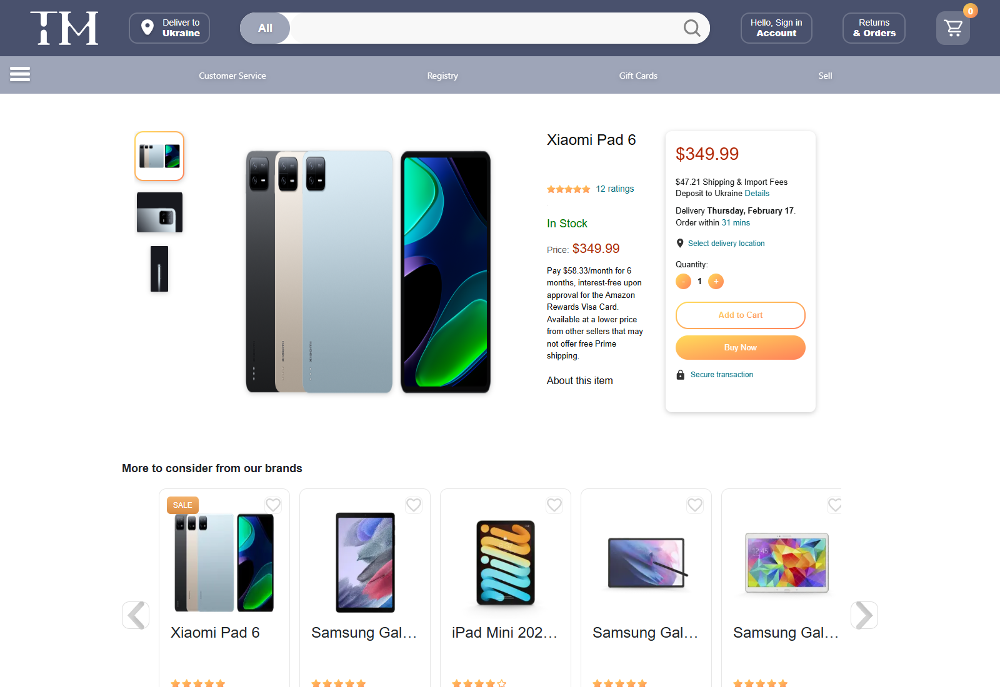</a><br>
      Product images, ratings, pricing and stock.<br>
      <a href="docs/images/storefront-product.png">Open full-size screenshot</a>
    </td>
    <td valign="top">
      <a href="docs/images/storefront-collections.png">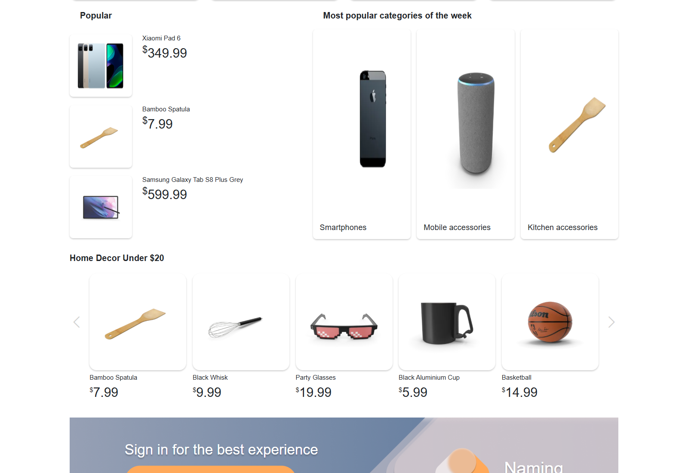</a><br>
      Popular products, categories and price-based collections.<br>
      <a href="docs/images/storefront-collections.png">Open full-size screenshot</a>
    </td>
  </tr>
  <tr>
    <th width="50%">Customer reviews</th>
    <th width="50%">Product questions and answers</th>
  </tr>
  <tr>
    <td valign="top">
      <a href="docs/images/storefront-reviews.png">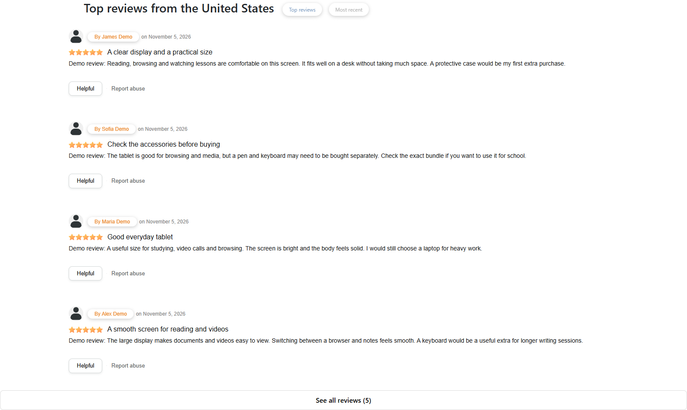</a><br>
      Ratings and reviews from the API.<br>
      <a href="docs/images/storefront-reviews.png">Open full-size screenshot</a>
    </td>
    <td valign="top">
      <a href="docs/images/storefront-questions.jpg">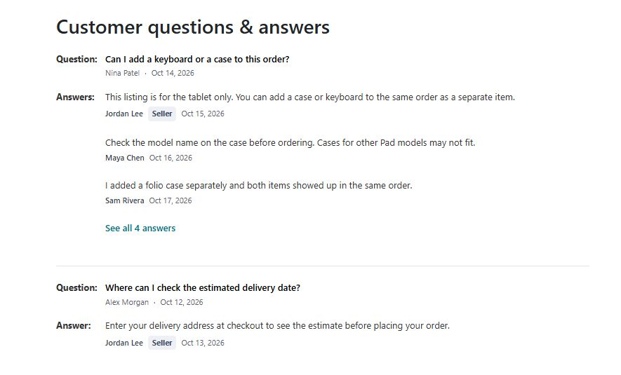</a><br>
      Up to three answers per question, with more available on demand.<br>
      <a href="docs/images/storefront-questions.jpg">Open full-size screenshot</a>
    </td>
  </tr>
</table>

### MVC admin panel (this repository)

The management interface is part of the ASP.NET Core backend. It uses Razor views for catalog management and supports light and dark themes.

<table>
  <tr>
    <th width="33%">Management dashboard</th>
    <th width="33%">Product listings</th>
    <th width="33%">Product editor</th>
  </tr>
  <tr>
    <td valign="top">
      <a href="docs/images/admin-dashboard-dark.png">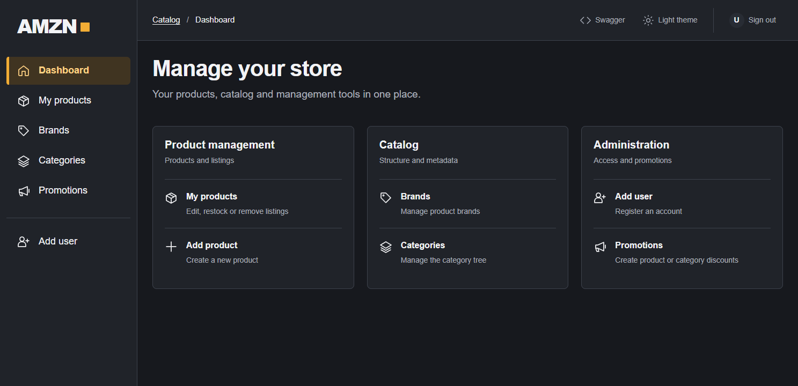</a><br>
      Catalog tools and management pages.<br>
      <a href="docs/images/admin-dashboard-dark.png">Open full-size screenshot</a>
    </td>
    <td valign="top">
      <a href="docs/images/admin-products.png">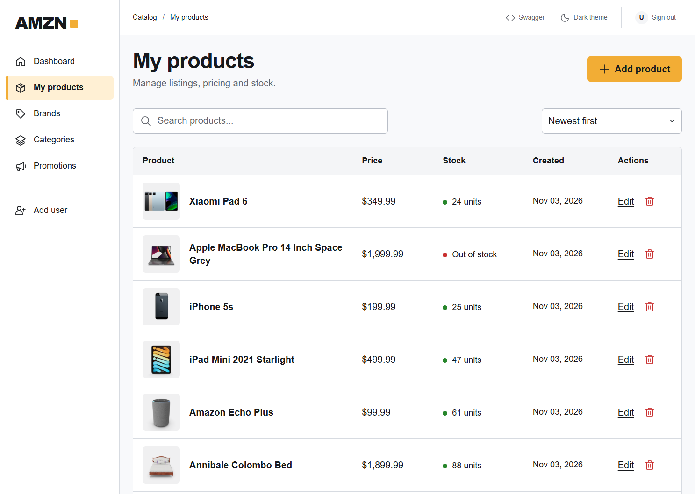</a><br>
      Search and sort the seller's catalog.<br>
      <a href="docs/images/admin-products.png">Open full-size screenshot</a>
    </td>
    <td valign="top">
      <a href="docs/images/admin-product-edit.png">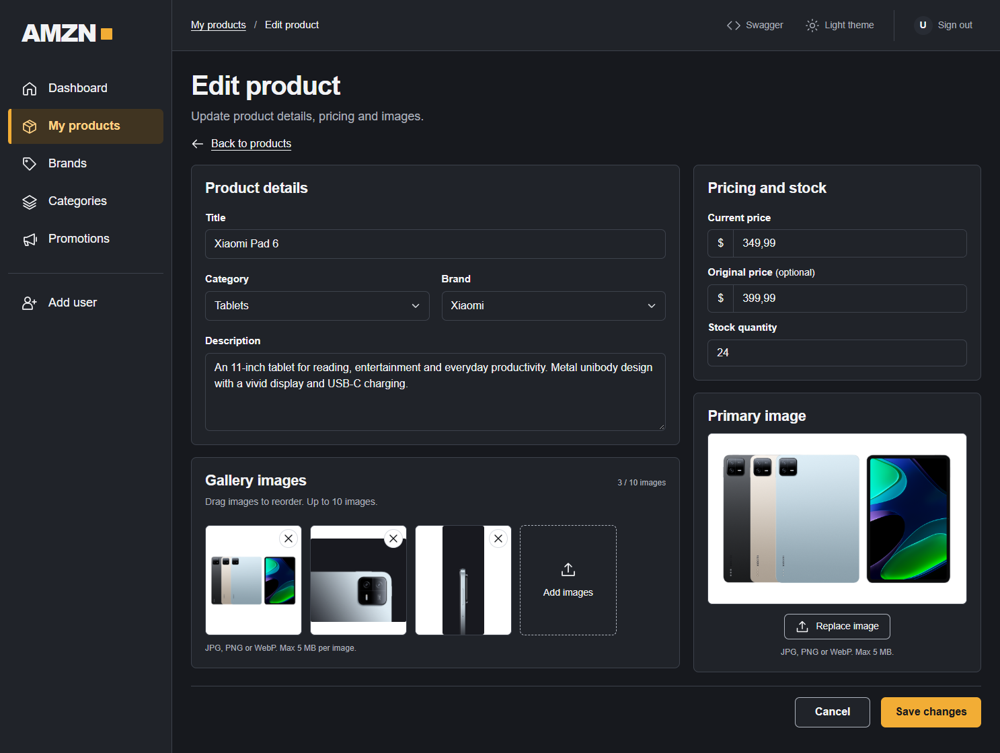</a><br>
      Edit product details, pricing and image galleries.<br>
      <a href="docs/images/admin-product-edit.png">Open full-size screenshot</a>
    </td>
  </tr>
</table>

### Admin UI scenarios

See form errors, image previews and mobile layouts. Click a preview to open that section in the gallery.

<table>
  <tr>
    <th width="33%">Form validation</th>
    <th width="33%">Image previews</th>
    <th width="33%">Mobile layout</th>
  </tr>
  <tr>
    <td valign="top" align="center">
      <a href="docs/admin-ui.md#form-validation">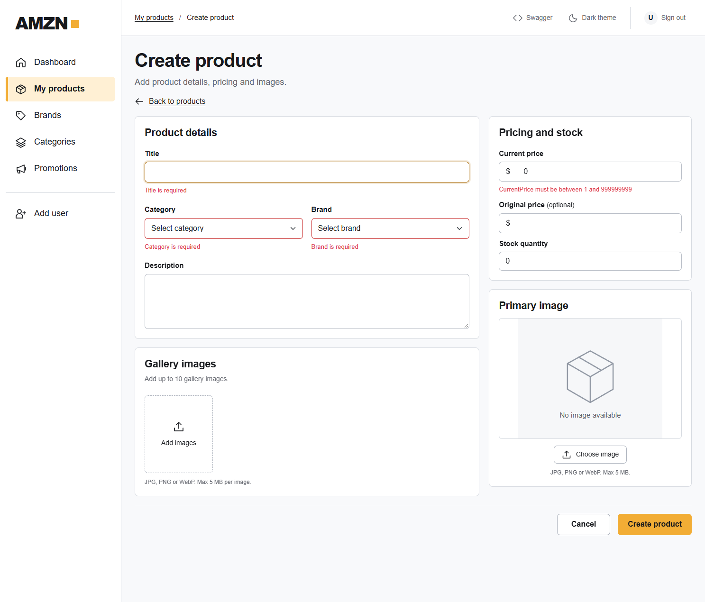</a><br>
      <a href="docs/admin-ui.md#form-validation">View validation scenario</a>
    </td>
    <td valign="top" align="center">
      <a href="docs/admin-ui.md#image-previews">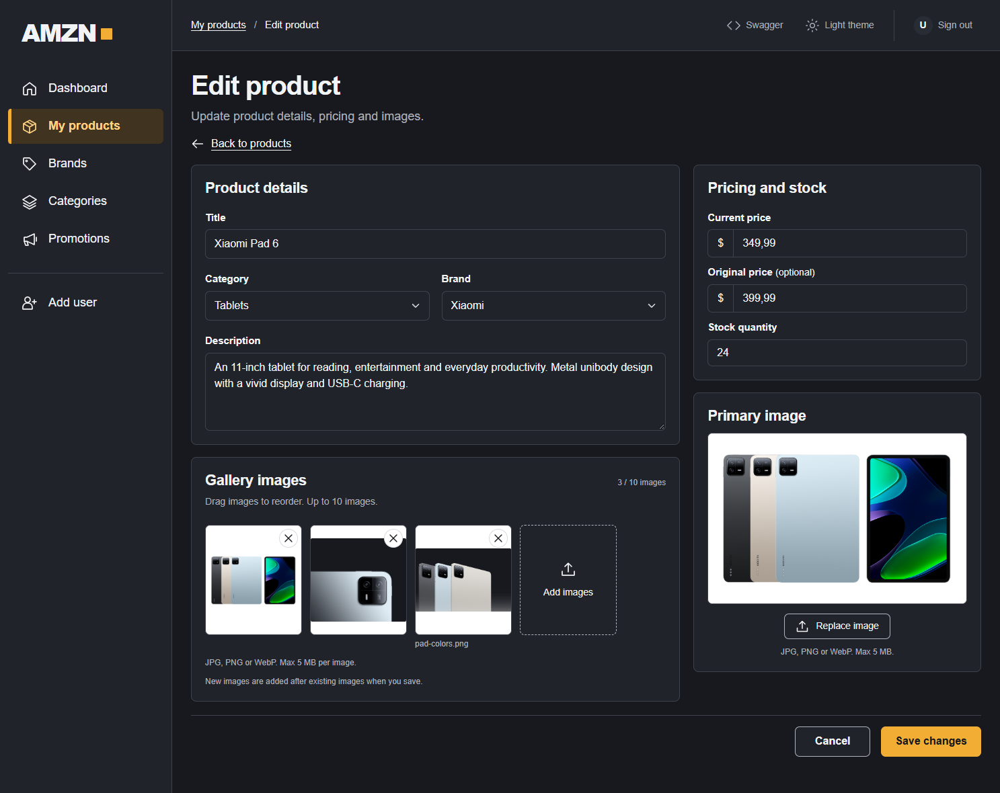</a><br>
      <a href="docs/admin-ui.md#image-previews">View gallery editing</a>
    </td>
    <td valign="top" align="center">
      <a href="docs/admin-ui.md#mobile-layouts">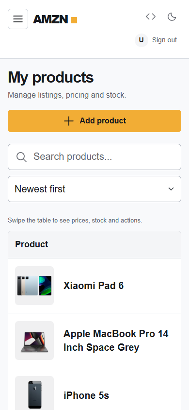</a><br>
      <a href="docs/admin-ui.md#mobile-layouts">View mobile layouts</a>
    </td>
  </tr>
  <tr>
    <td colspan="3" align="center">
      <strong><a href="docs/admin-ui.md">Browse the full admin UI gallery</a></strong><br>
      9 screenshots of the dashboard, catalog, editor, form errors, delete confirmation and mobile navigation.
    </td>
  </tr>
</table>

## Tech stack

- C# / .NET 9
- ASP.NET Core Web API and MVC with Razor views
- Entity Framework Core 9 and SQL Server / Azure SQL Database
- JWT Bearer authentication and BCrypt password hashing
- Azure Blob Storage
- Azure App Service
- Swagger / OpenAPI

## Features

- Product catalog with category, brand, price, and rating filters.
- Product details, image galleries, search suggestions, and homepage collections.
- Customer ratings and reviews, with options to update them.
- Product questions and answers with seller-response identification.
- User profiles, delivery addresses, and demo payment-method records.
- Shopping cart, order creation, confirmation, cancellation, and order history.
- MVC management pages for products, categories, brands, and promotions, with light and dark themes.
- Promotion date checks at startup, with optional periodic checks.

### MVC management interface

- A responsive dashboard and navigation for desktop and mobile screens.
- Product listings for the signed-in seller, with search and sorting by title, price or creation date.
- Product creation and editing with category, brand, pricing and stock fields, plus client-side and server-side validation.
- Image previews and drag-and-drop gallery uploads. Existing gallery images can be reordered or removed before saving.
- Product deletion confirmation and helpful empty search states.
- Light and dark themes that remember the user's choice, with account controls in the top bar.

## Architecture and implementation

The application uses controller, service and repository layers in a single ASP.NET Core project.

```text
Controllers/     API endpoints and MVC controllers
Services/        Business logic and background processing
Repositories/    Database queries and persistence
Data/            Entities and EF Core model configuration
DTOs/            API request and response contracts
Models/          MVC form and view models
Security/        Password hashing and JWT generation
Shared/          Storage, transactions, validation, and helpers
Middleware/      API exception handling
Views/           Razor management interface
Migrations/      SQL Server database migrations
```

### Authentication

The API and MVC interface use the same JWT authentication. API clients can send access tokens in the `Authorization: Bearer` header. Browser clients can also use the `amzn_access` cookie. If both are present, the header is used.

Refresh tokens are stored as hashes. When a refresh token is used, the old token is revoked and a new one is created in the same database transaction.

### Database consistency

Rating and review updates use database transactions and SQL Server locking hints (`UPDLOCK`, `ROWLOCK`). This makes updates to the same product run one at a time. Unique indexes limit each user to one rating and one review per product.

Adding delivery addresses and payment methods uses transactions and per-user locks. These protect checks for duplicates and the choice of a default address or payment method.

### Database diagram

The diagram shows the SQL Server schema before the image upload usage table was added. Click it to view it at full size.

<a href="docs/images/database-schema.png">
  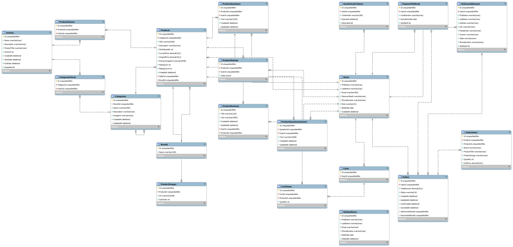
</a>

**[Open full-size database diagram](docs/images/database-schema.png)**

[Schema details and notation](docs/database-schema.md)

### Queries and background processing

Question previews show up to three answers per question. The database query handles sorting and the three-answer limit.

A background service checks promotion dates once when the application starts. Set `Promotions:EnablePeriodicChecks` to `true` to repeat the check every minute while the application is running. The service applies or removes discounts based on their start and end dates.

## API explorer

**[Open live Swagger UI](https://amzn-backend.azurewebsites.net/swagger)** to explore the endpoints. It supports authenticated requests through its **Authorize** dialog.

Click a preview or its **Open full size** link to read the endpoint list.

<table>
  <tr>
    <th width="33%">Products and community</th>
    <th width="33%">Authentication and management</th>
    <th width="33%">Cart and orders</th>
  </tr>
  <tr>
    <td valign="top">
      <a href="docs/images/swagger-products.png">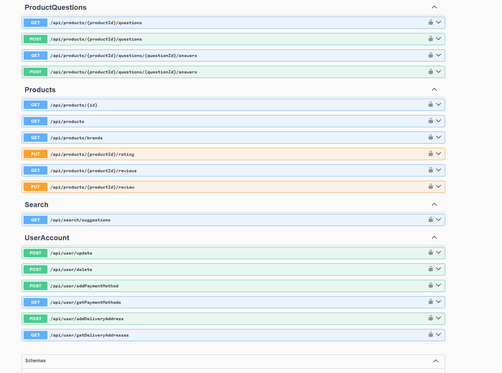</a><br>
      <a href="docs/images/swagger-products.png">Open full size</a>
    </td>
    <td valign="top">
      <a href="docs/images/swagger-auth-management.png">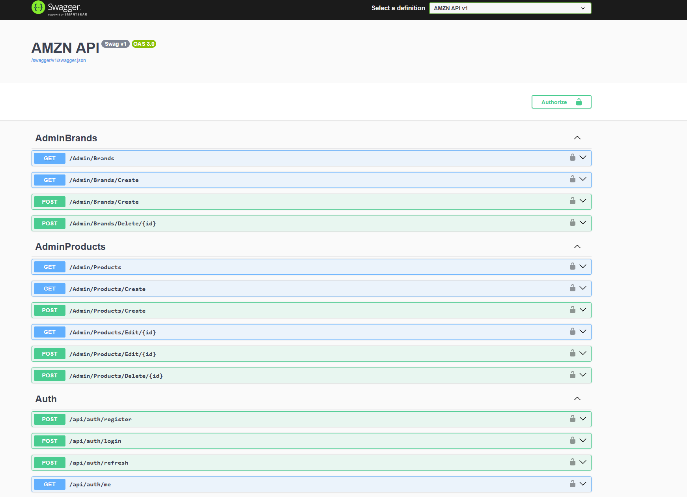</a><br>
      <a href="docs/images/swagger-auth-management.png">Open full size</a>
    </td>
    <td valign="top">
      <a href="docs/images/swagger-cart-orders.png">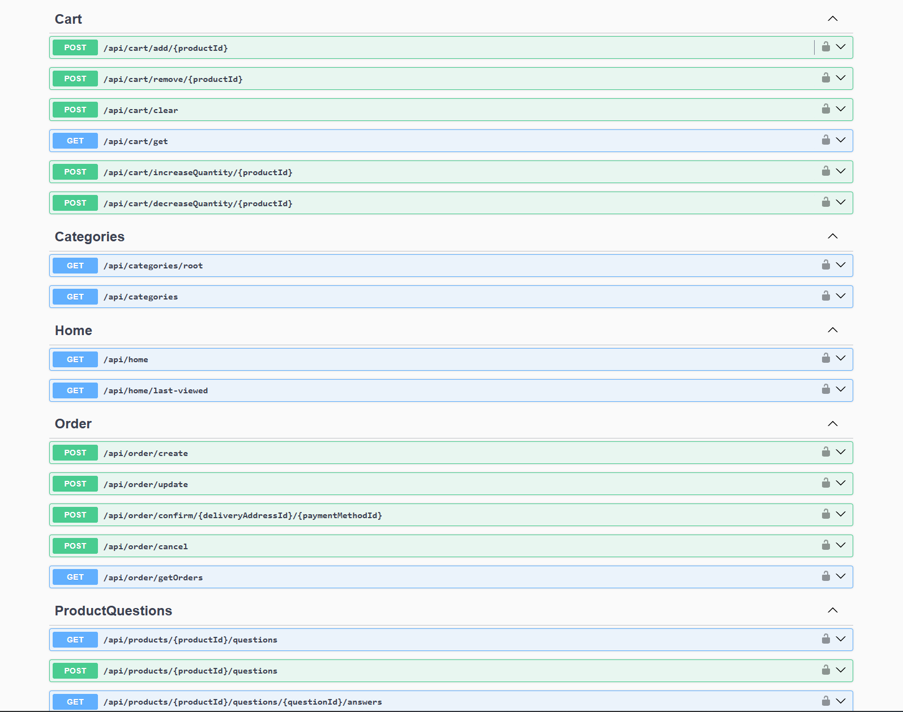</a><br>
      <a href="docs/images/swagger-cart-orders.png">Open full size</a>
    </td>
  </tr>
</table>

## Tests

Run the tests from the project root:

```powershell
dotnet test AMZN.sln
```

The tests cover image validation, shared limits across request models and EF Core, JWT handling, forwarded headers and request limits. HTTP tests also check shared counters, 429 responses and the 25 MiB request limit.

Some HTTP tests start a local server to check the total request size. The default test run needs no SQL Server, Azure or secret settings. To run the SQL tests for the upload quota, pagination, checkout and promotions on Windows, install SQL Server LocalDB and set `AMZN_TEST_LOCALDB=1`. These tests use temporary databases, not the application database.

See [deployment checks](docs/deployment-checks.md) for the manual IP and rate-limit check after publishing.

## Running locally

### Prerequisites

- .NET 9 SDK
- SQL Server, or SQL Server Express LocalDB on Windows
- Entity Framework Core CLI tools matching the project's EF Core version
- An Azure Storage account to enable image uploads (optional for browsing the application)

If the EF Core CLI is not installed:

```powershell
dotnet tool install --global dotnet-ef --version 9.0.12
```

### 1. Configure the application

Create `appsettings-Secrets.json` in the project root:

```json
{
  "ConnectionStrings": {
    "DefaultConnection": "Server=(localdb)\\MSSQLLocalDB;Database=AMZN_DB;Trusted_Connection=True;TrustServerCertificate=True;",
    "AzureStorage": ""
  },
  "Jwt": {
    "Key": "<Base64-encoded random signing key>",
    "Issuer": "AMZN",
    "Audience": "AMZN.Client",
    "ExpiresMinutes": 30,
    "RefreshDays": 7
  }
}
```

The SQL Server connection string above uses Windows LocalDB. Replace it with your own connection string if using another SQL Server instance.

`Jwt:Key` must contain at least 32 random bytes encoded as Base64. Generate a key in PowerShell:

```powershell
$keyBytes = New-Object byte[] 32
$rng = [System.Security.Cryptography.RandomNumberGenerator]::Create()
$rng.GetBytes($keyBytes)
[Convert]::ToBase64String($keyBytes)
$rng.Dispose()
```

Copy the generated value into `Jwt:Key`.

`appsettings-Secrets.json` is excluded from Git. Keep credentials and signing keys out of committed configuration files.

### 2. Restore dependencies and apply migrations

Run from the project root:

```powershell
dotnet restore
dotnet ef database update
```

### 3. Start the application

Open `AMZN.sln` in Visual Studio, select the `https` profile and run the project.

Or run it from the terminal:

```powershell
dotnet run --launch-profile https
```

If the browser warns about the local HTTPS certificate, trust the development certificate once:

```powershell
dotnet dev-certs https --trust
```

Local URLs:

- [MVC interface](https://localhost:7202/)
- [Swagger UI](https://localhost:7202/swagger)
- [OpenAPI document](https://localhost:7202/swagger/v1/swagger.json)

Swagger and the API documentation links are controlled by `Swagger:Enabled` in the application settings.

### 4. Enable image uploads

To enable uploads, set `ConnectionStrings:AzureStorage` to your Azure Storage connection string and restart the application. The `amzn-storage` container is created automatically on the first image upload if it does not already exist.

Catalog images use public blob URLs. The storage account must allow anonymous blob access. If you use an existing container, enable public read access for its blobs.

Image uploads have a shared allowance of 500 MiB per UTC calendar month by default. Existing images stay available when the limit is reached. Use `ImageUploads:MonthlyLimitMiB` to change the allowance, or set `ImageUploads:Enabled` to `false` to pause new uploads.

You can leave `AzureStorage` empty to explore the API and MVC pages without image uploads. If you try to upload an image, the app shows an error message. Browsing product lists does not require a server-side connection to Blob Storage.

### 5. Explore the project

For API access, register through `POST /api/auth/register` or sign in through `POST /api/auth/login`. Copy the returned `accessToken` into the Swagger **Authorize** dialog.

For a local management demo, create an account at `/Admin/SignUp`, select the `Admin` role, and sign in through the MVC interface. Create categories and brands before adding products. Creating categories and products with images requires configured Blob Storage.

A new database starts without catalog data. Use test account and payment details when trying the demo features.
