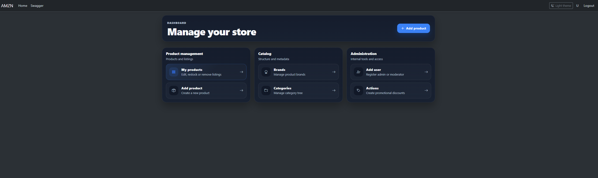

# AMZN - E-commerce Backend

An Amazon-inspired e-commerce backend built with ASP.NET Core, Entity Framework Core and SQL Server. It provides a REST API for a separate React storefront and an MVC interface for catalog management.

Built collaboratively by three frontend developers and two backend developers, following a shared Figma design. This repository contains the backend and MVC management interface; the storefront is maintained separately.

## My contribution

My primary responsibility was the backend core, including:

- Core API structure, service and repository layers, and Entity Framework Core data access.
- JWT authentication, password hashing, and refresh-token handling.
- Product catalog, filtering, sorting, pagination, search suggestions, and homepage APIs.
- Product ratings, reviews, and questions and answers.
- Product management, image galleries, and Azure Blob Storage integration.

## Project preview

Catalog browsing with category, brand, rating and price filters, plus sorting options.

<a href="docs/images/storefront-catalog.png">
  
</a>

Storefront screenshots are from the team demo. The React frontend was developed by the frontend team and is maintained separately.

Click any preview below to open the full-size screenshot.

<table>
  <tr>
    <th width="50%">Storefront search</th>
    <th width="50%">MVC management interface</th>
  </tr>
  <tr>
    <td valign="top">
      <a href="docs/images/storefront-search.png"></a><br>
      Product suggestions as the user types.<br>
      <a href="docs/images/storefront-search.png">Open full-size screenshot</a>
    </td>
    <td valign="top">
      <a href="docs/images/admin-dashboard.png"></a><br>
      Product and catalog management, with light and dark themes.<br>
      <a href="docs/images/admin-dashboard.png">Open full-size screenshot</a>
    </td>
  </tr>
</table>

## Tech stack

- C# / .NET 9
- ASP.NET Core Web API and MVC with Razor views
- Entity Framework Core 9 and SQL Server
- JWT Bearer authentication and BCrypt password hashing
- Azure Blob Storage
- Swagger / OpenAPI

## Features

- Product catalog with category, brand, price, and rating filters.
- Product details, image galleries, search suggestions, and homepage collections.
- Customer ratings and reviews, including updates to existing submissions.
- Product questions and answers with seller-response identification.
- User profiles, delivery addresses, and demo payment-method records.
- Shopping cart, order creation, confirmation, cancellation, and order history.
- MVC management pages for products, categories, brands, and promotions, with light and dark themes.
- Scheduled promotion activation and expiration.

## Architecture and implementation

The application is organized into controller, service, and repository layers within a single ASP.NET Core project.

```text
Controllers/     API endpoints and MVC controllers
Services/        Business logic and background processing
Repositories/    Database queries and persistence
Data/            Entities and EF Core model configuration
DTOs/            API request and response contracts
Models/          MVC form and view models
Security/        Password hashing and JWT generation
Shared/          Storage, transactions, validation, and helpers
Middleware/      API exception handling
Views/           Razor management interface
Migrations/      SQL Server database migrations
```

### Authentication

The API and MVC interface share the same JWT authentication mechanism. API clients can send access tokens through the `Authorization: Bearer` header; browser clients can also use the `amzn_access` cookie. An explicit authorization header takes precedence over the cookie.

Refresh tokens are stored as hashes. Token rotation revokes the previous token and creates its replacement within a database transaction.

### Database consistency

Rating and review updates use database transactions and SQL Server locking hints (`UPDLOCK`, `ROWLOCK`) to serialize concurrent updates for the same product. Unique indexes enforce one rating and one review per user and product.

Adding delivery addresses and payment methods uses transactions and per-user locking to coordinate duplicate checks and default selections.

### Database diagram

The SQL Server schema includes 20 application tables and 27 foreign-key relationships. Click the diagram to open its full-size SVG version.

<a href="docs/images/database-schema.svg">
  
</a>

**[Open full-size database diagram (SVG)](docs/images/database-schema.svg)**

[Schema details and notation](docs/database-schema.md) | [Editable Workbench model](docs/diagrams/amzn-database.mwb)

### Queries and background processing

Question previews retrieve up to three answers per question, with ordering and limits applied in the database query.

A hosted background service checks promotion validity at startup and every minute while the application is running, applying or removing discounts according to their start and end dates.

## API explorer

Swagger UI documents the API and supports authenticated requests through its **Authorize** dialog.

Click a preview or its **Open full size** link to read the endpoint list.

<table>
  <tr>
    <th width="33%">Products and community</th>
    <th width="33%">Authentication and management</th>
    <th width="33%">Cart and orders</th>
  </tr>
  <tr>
    <td valign="top">
      <a href="docs/images/swagger-products.png"></a><br>
      <a href="docs/images/swagger-products.png">Open full size</a>
    </td>
    <td valign="top">
      <a href="docs/images/swagger-auth-management.png"></a><br>
      <a href="docs/images/swagger-auth-management.png">Open full size</a>
    </td>
    <td valign="top">
      <a href="docs/images/swagger-cart-orders.png"></a><br>
      <a href="docs/images/swagger-cart-orders.png">Open full size</a>
    </td>
  </tr>
</table>

## Running locally

### Prerequisites

- .NET 9 SDK
- SQL Server, or SQL Server Express LocalDB on Windows
- Entity Framework Core CLI tools matching the project's EF Core version
- An Azure Storage account to enable image uploads (optional for browsing the application)

If the EF Core CLI is not installed:

```powershell
dotnet tool install --global dotnet-ef --version 9.0.12
```

### 1. Configure the application

Create `appsettings-Secrets.json` in the project root:

```json
{
  "ConnectionStrings": {
    "DefaultConnection": "Server=(localdb)\\MSSQLLocalDB;Database=AMZN_DB;Trusted_Connection=True;TrustServerCertificate=True;",
    "AzureStorage": ""
  },
  "Jwt": {
    "Key": "<Base64-encoded random signing key>",
    "Issuer": "AMZN",
    "Audience": "AMZN.Client",
    "ExpiresMinutes": 30,
    "RefreshDays": 7
  }
}
```

The SQL Server connection string above uses Windows LocalDB. Replace it with your own connection string if using another SQL Server instance.

`Jwt:Key` must contain at least 32 random bytes encoded as Base64. Generate a key in PowerShell:

```powershell
$keyBytes = New-Object byte[] 32
$rng = [System.Security.Cryptography.RandomNumberGenerator]::Create()
$rng.GetBytes($keyBytes)
[Convert]::ToBase64String($keyBytes)
$rng.Dispose()
```

Copy the generated value into `Jwt:Key`.

`appsettings-Secrets.json` is excluded from Git. Keep credentials and signing keys out of committed configuration files.

### 2. Restore dependencies and apply migrations

Run from the project root:

```powershell
dotnet restore
dotnet ef database update
```

### 3. Start the application

```powershell
dotnet dev-certs https --trust
dotnet run --launch-profile https
```

Local URLs:

- [MVC interface](https://localhost:7202/)
- [Swagger UI](https://localhost:7202/swagger)
- [OpenAPI document](https://localhost:7202/swagger/v1/swagger.json)

Swagger is enabled in the Development environment.

### 4. Enable image uploads

To enable uploads, set `ConnectionStrings:AzureStorage` to your Azure Storage connection string and restart the application. The `amzn-storage` container is created automatically on the first image upload if it does not already exist.

Catalog images are served through public blob URLs. The storage account must allow anonymous blob access; if you provide an existing container, configure it for public blob read access.

You can leave `AzureStorage` empty to explore the API and MVC pages without image uploads. Upload attempts then return an explanatory error. Browsing product lists does not require a server-side connection to Blob Storage.

### 5. Explore the project

For API access, register through `POST /api/auth/register` or sign in through `POST /api/auth/login`. Copy the returned `accessToken` into the Swagger **Authorize** dialog.

For a local management demo, create an account at `/Admin/SignUp`, select the `Admin` role, and sign in through the MVC interface. Create categories and brands before adding products. Creating categories and products with images requires configured Blob Storage.

A new database starts without catalog data. Use fictitious account and payment information when exploring the demo workflows.
