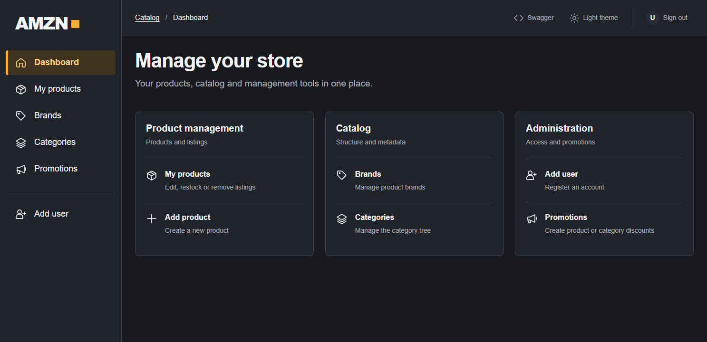
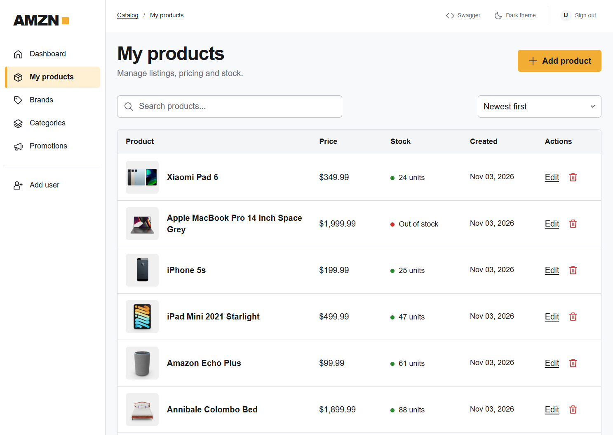
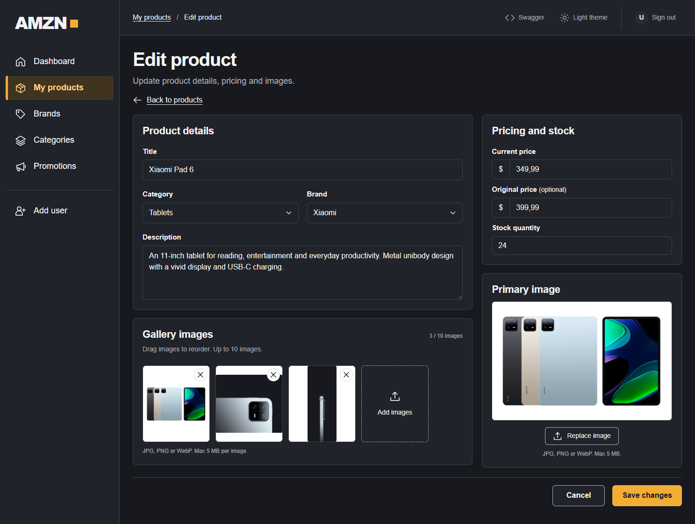
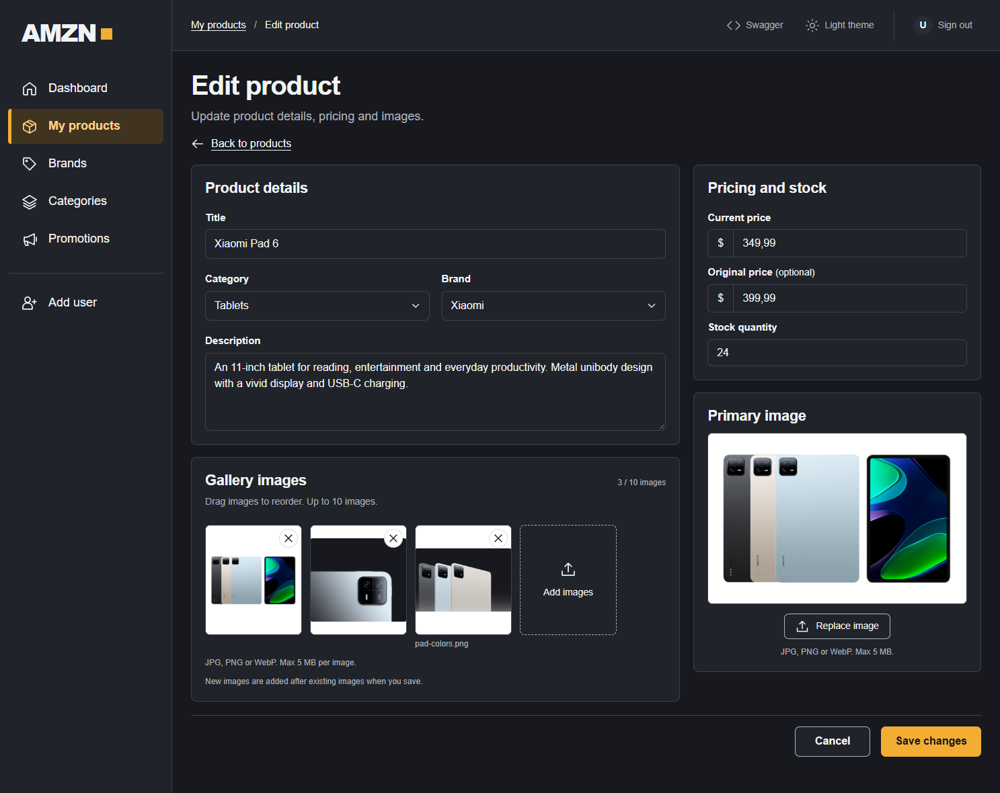
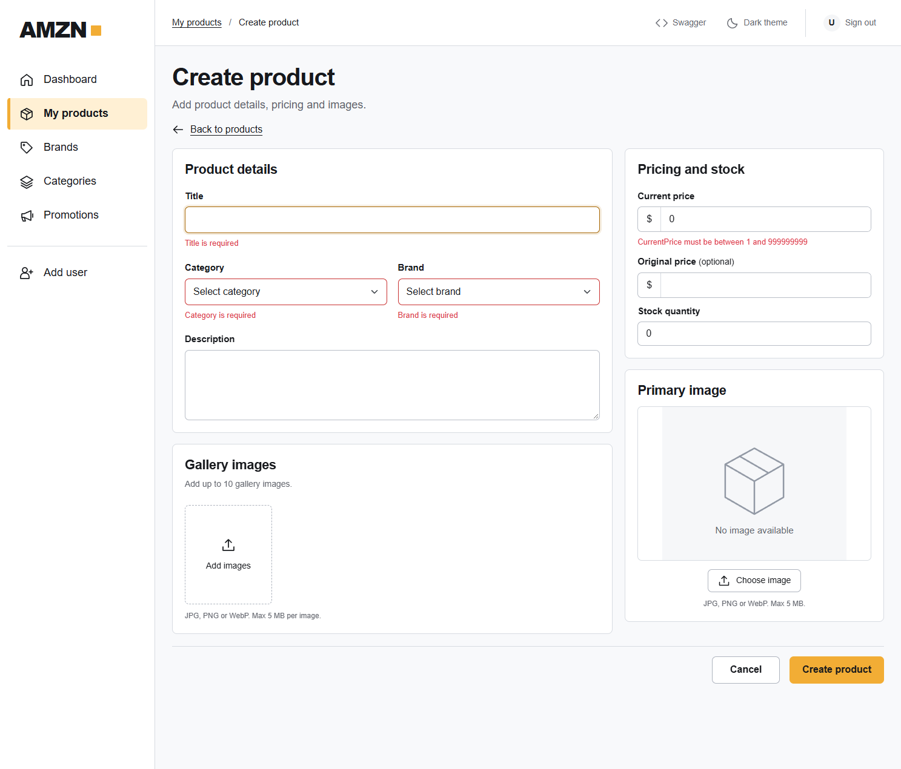
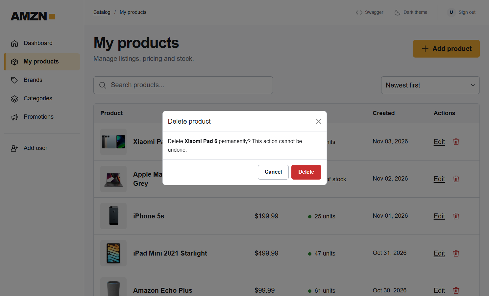
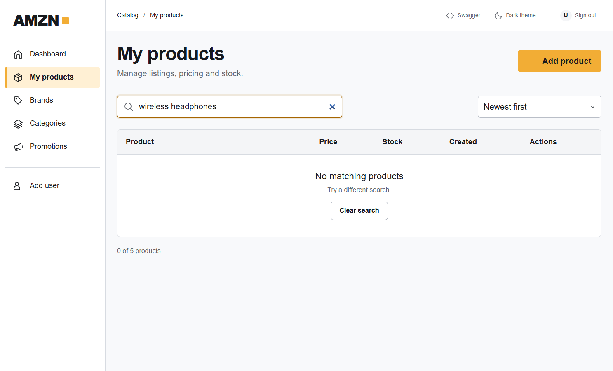
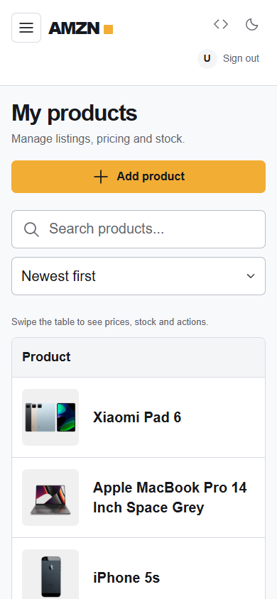
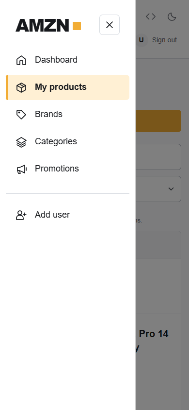

# Admin UI gallery

[Back to the project README](../README.md)

The MVC interface supports catalog management on desktop and mobile screens. These screenshots use a local demo catalog and show both light and dark themes.

**Browse the interface:** [Dashboard](#dashboard) · [Product listings](#product-listings) · [Product editor](#product-editor)

**Explore scenarios:** [Image previews](#image-previews) · [Form validation](#form-validation) · [Delete confirmation](#delete-confirmation) · [Empty search](#empty-search) · [Mobile layouts](#mobile-layouts)

Click any screenshot to open the original image at full size.

## Dashboard

Use the sidebar to open products, brands, categories and promotions. Theme and account controls are in the top bar.

[Open full-size dashboard](images/admin-dashboard-dark.png)

## Product listings

Sellers can see their products, prices and stock levels. Search and sort apply to all their products, with 20 results per page.

[Open full-size product listings](images/admin-products.png)

## Product editor

The editor groups product details and gallery images on the left, with pricing, stock and the primary image on the right. Save and cancel buttons are at the end of the form.

[Open full-size product editor](images/admin-product-edit.png)

## Image previews

A new image appears in the gallery before saving. Existing images can be reordered or removed from the form. The primary image has its own preview and a button to replace it.

[Open full-size image preview](images/admin-gallery-preview.png)

## Form validation

If required fields are empty or values are invalid, the form shows messages next to those fields. This example shows a missing title, category and brand, plus an invalid price.

[Open full-size validation example](images/admin-form-validation.png)

## Delete confirmation

The dialog shows the product name and warns that deletion is permanent. The user can cancel without changing the catalog.

[Open full-size confirmation dialog](images/admin-delete-confirmation.png)

## Empty search

If no products match the search, the page shows a message and a Clear search button. Search and sort controls stay visible.

[Open full-size empty search state](images/admin-search-empty.png)

## Mobile layouts

On mobile screens, a menu button opens the navigation drawer. Search and sort controls appear one below the other. Users can swipe the product table to see prices, stock and actions.

<table>
  <tr>
    <th width="50%">Product catalog</th>
    <th width="50%">Navigation drawer</th>
  </tr>
  <tr>
    <td align="center" valign="top">
       
      <a href="images/admin-mobile-catalog.png">Open full-size mobile catalog</a>
    </td>
    <td align="center" valign="top">
       
      <a href="images/admin-mobile-navigation.png">Open full-size navigation drawer</a>
    </td>
  </tr>
</table>

---

[Back to the project README](../README.md) · [Back to gallery navigation](#admin-ui-gallery)

Sample product data and images: [DummyJSON](https://dummyjson.com/docs/products). Xiaomi Pad 6 images: [Xiaomi](https://www.mi.com/global/product/xiaomi-pad-6/).
