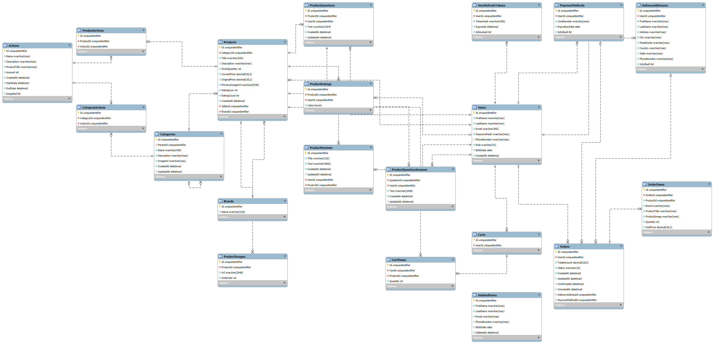

# Database schema

This diagram is a snapshot of the SQL Server schema `AMZN` before `ImageUploadUsage` was added for the monthly image upload quota. The snapshot has 20 application tables, 125 columns and 27 foreign keys. EF Core's migration-history table is not shown.

The layout follows the application's main areas: catalog and promotions on the left, ratings and Q&A in the center, accounts and orders on the right.

[Open full-size SVG](images/database-schema.svg) | [Open full-size PNG](images/database-schema.png) | [Download editable Workbench model](diagrams/amzn-database.mwb)

## Notation

- A key icon marks a primary-key column; red diamonds mark foreign-key columns.
- Filled column diamonds indicate `NOT NULL`; hollow diamonds indicate nullable columns.
- Relationships use Crow's Foot notation: a bar means one, a circle means optional and the three-pronged end means many.
- Dashed connectors represent non-identifying relationships, not nullable foreign keys. Nullability is shown by the column icons and relationship endpoints.
- Index definitions are stored in the Workbench model; the diagram keeps their sections collapsed.

The diagram preserves SQL Server types such as `uniqueidentifier`, `nvarchar`, `datetime2` and `bit`. The application and database have not been converted to MySQL; Workbench is used only for the diagram.

`OrderItems.ProductId` is a stored product identifier without a foreign-key constraint. `DeletedUsers` has no foreign-key relationship to `Users`. These reflect the current database structure.

For EF Core configuration and check constraints, see [DataContext](../Data/DataContext.cs) and the [migration snapshot](../Migrations/DataContextModelSnapshot.cs).
